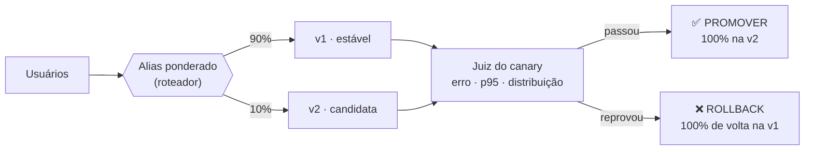
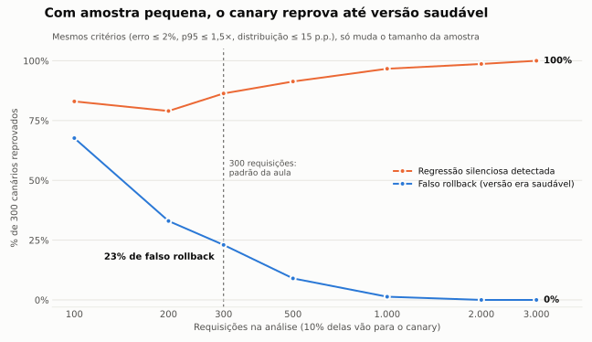

# canary-deploy-ia 🐤

**Como colocar uma versão nova de um modelo de IA em produção sem quebrar nada, e por que "não deu erro" não quer dizer "deu certo".**

Um demo que roda em 10 segundos, sem nuvem, de um **canary release** para modelos: a versão nova recebe só uma fatia do tráfego, um juiz compara ela com a versão estável e decide sozinho entre **promover** e **rollback**.

Feito a partir do que aprendi na aula de **Deploy and CI/CD** do MBA em AI Engineering & Multi-Agents da [FIAP](https://www.fiap.com.br/), onde rodei o mesmo fluxo de verdade em AWS Lambda com GitHub Actions ([resultados reais abaixo](#o-mesmo-fluxo-na-aws-de-verdade)).

```bash
git clone https://github.com/everson-chaves/canary-deploy-ia && cd canary-deploy-ia
python demo.py
```

---

## A ideia em um desenho



Trocar o modelo para todo mundo de uma vez (*big bang deploy*) faz qualquer regressão atingir 100% dos usuários na hora. No canary, ela atinge só a fatia exposta, e a volta é automática.

## Os três critérios do juiz

| Sinal | Reprova se | Pergunta que responde |
|---|---|---|
| Taxa de erro | canary > 2% ou mais de 1 p.p. acima da estável | Está quebrando? |
| Latência p95 | canary > 1,5 × a da estável | Está lento? |
| Distribuição das previsões | diferença > 15 p.p. em qualquer classe | **Está decidindo diferente?** |

O terceiro não existe num serviço comum. Num serviço determinístico, resposta 200 e rápida é resposta certa. Um modelo pode responder 200, rápido, sem exceção nenhuma, e **mesmo assim ter mudado de opinião**. Essa é a regressão silenciosa, e só se enxerga comparando *o que* cada versão decide.

## Os cenários

`python demo.py` roda todos. Cada um tem um defeito diferente (ou nenhum):

| Cenário | O que tem de errado | Decisão | Quem pegou |
|---|---|---|---|
| `saudavel` | nada | ✅ promover | — |
| `erro` | 20% das chamadas falham | ❌ rollback | taxa de erro |
| `lenta` | 2× mais lenta | ❌ rollback | latência p95 |
| `drift` | **0% de erro, mesma velocidade**, mas puxa 40% das previsões para "positiva" | ❌ rollback | **distribuição** |
| `cold_start` (300 req.) | saudável, mas as 3 primeiras chamadas são frias | ❌ rollback **falso** | latência p95 |
| `cold_start` (1.000 req.) | o mesmo | ✅ promover | — |

O cenário `drift` é o mais importante: nenhum alarme técnico tocaria. Exemplo de saída:

```
| versão     | req. | erro | p95   | positiva | negativa | neutra |
| v1-estavel | 909  | 0.0% | 50 ms | 42%      | 34%      | 24%    |
| v2-canary  | 91   | 0.0% | 49 ms | 66%      | 21%      | 13%    |

❌ ROLLBACK — previsões 'positiva' mudaram 24%
```

## Quantas requisições o canary precisa?

Este foi o achado mais interessante. Rodei cada tamanho de amostra 300 vezes (`python experimento.py`):



| Requisições | Falso rollback (versão saudável reprovada) | Regressão silenciosa detectada |
|---|---|---|
| 100 | 68% | 83% |
| 300 | **23%** | 86% |
| 1.000 | 1% | 97% |
| 3.000 | 0% | 100% |

Com 10% do tráfego, 300 requisições põem só ~30 no canary. Com tão pouco, o simples acaso do sorteio já muda a distribuição das classes em mais de 15 p.p. **Um gatilho de rollback é tão bom quanto o tamanho da amostra que ele olha.**

## O mesmo fluxo na AWS, de verdade

Na aula, o mesmo canary rodou em **AWS Lambda** (alias `producao` com `AdditionalVersionWeights`) disparado por **GitHub Actions**:

| Run | Configuração | Erro do canary | p95 estável / canary | Resultado |
|---|---|---|---|---|
| Saudável | 10% do tráfego, 1.000 req. | 0% | 149 / 155 ms | ✅ promovida |
| Com falha | 20% de erro simulado | 25% | 242 / 9.719 ms | ❌ rollback automático |
| Saudável | 10% do tráfego, **300 req.** | 0% | 152 / **5.462 ms** | ❌ rollback **falso** (cold start) |
| Manual, saudável | 20% do tráfego, 1.000 req. | 0% | 41 / 43 ms | ✅ promovida |
| Manual, com falha | 20% de erro simulado | 16,1% | 178 / 178 ms | ❌ rollback automático |

O terceiro run foi o que me fez montar este repositório. A versão estava perfeita e foi reprovada. Ela tinha acabado de subir no Lambda, as primeiras chamadas pagaram o *cold start* (carregar o modelo), e com só 30 requisições no canary isso dominou o p95. O cenário `cold_start` daqui reproduz exatamente isso.

## E se o que vai para canary for um prompt?

Em um agente conversacional (LLM), a taxa de erro HTTP deixa de servir: **o agente responde 200 até quando recusa um reembolso que deveria aprovar**. O "erro" dele é de comportamento. Os sinais que substituem a taxa de erro:

- **taxa de recusa** de pedidos que eram elegíveis
- **taxa de escalonamento** para um humano
- **sucesso na tarefa**, medido por amostragem ou LLM-as-judge
- **custo por chamada** (tokens), porque um prompt mais "explicativo" pode custar bem mais

E a sessão de cada usuário fica presa à versão de prompt que recebeu primeiro, para não misturar dois comportamentos na mesma conversa.

## Canary não é A/B test

| | Canary | A/B test |
|---|---|---|
| Pergunta | A versão nova é **segura**? | A versão nova é **melhor** para o negócio? |
| Métrica | erro, latência, regressão técnica | conversão, receita, satisfação |
| Duração | horas a poucos dias | semanas (significância estatística) |

Normalmente uma versão passa primeiro pelo canary e só depois pelo A/B.

## Estrutura

```
canary/
  modelo.py     classificador de sentimento + versões com defeitos simuláveis
  roteador.py   alias ponderado (o papel do alias do Lambda)
  analise.py    o juiz: mede as versões e decide promover ou rollback
  dados.py      avaliações de produto geradas por modelos de frase
demo.py         roda os cenários (use --esperado no CI)
experimento.py  falso rollback × tamanho da amostra (gera docs/amostra.svg)
tests/          pytest
.github/workflows/canary.yml   CI: testes + um canary por cenário
```

O CI roda um job por cenário e confere se a decisão foi a **certa**. O saudável precisa promover e os defeituosos precisam dar rollback, então o pipeline fica verde quando o juiz acerta.

```bash
pip install -r requirements.txt
python -m pytest -q                                   # testes
python demo.py --cenario drift                        # um cenário
python demo.py --cenario cold_start --requisicoes 300 # o falso rollback
python experimento.py                                 # o gráfico
```

---

Feito por **Everson Chaves** · aluno do MBA em AI Engineering & Multi-Agents (FIAP) · Licença MIT
